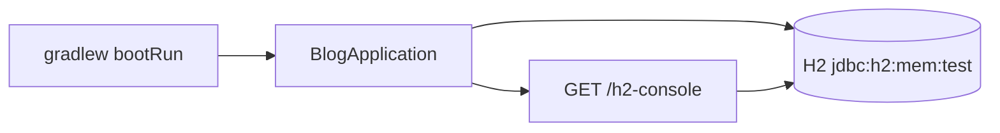
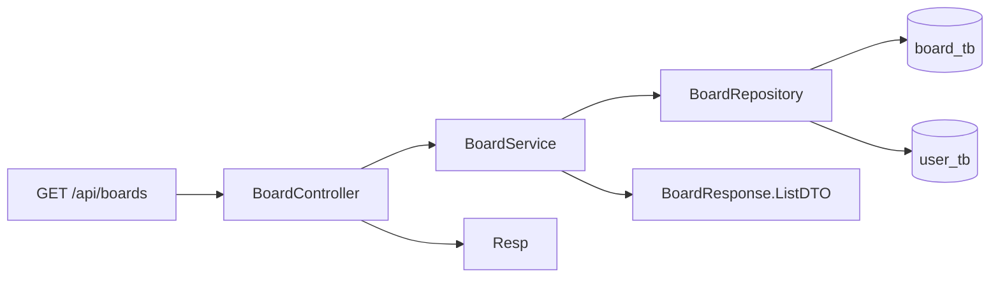

# 시나리오별 구조도

## 서버 실행과 H2 콘솔 접속

만든 장: project-setup
맡는 파일
- server-spring/build.gradle
- server-spring/src/main/java/com/newtenco/blog/BlogApplication.java
- server-spring/src/main/resources/application.properties

## 글 목록 보기

만든 장: board-list
맡는 파일
- server-spring/src/main/java/com/newtenco/blog/board/BoardController.java
- server-spring/src/main/java/com/newtenco/blog/board/BoardService.java
- server-spring/src/main/java/com/newtenco/blog/board/BoardRepository.java
- server-spring/src/main/java/com/newtenco/blog/board/BoardResponse.java
- server-spring/src/main/java/com/newtenco/blog/board/Board.java
- server-spring/src/main/java/com/newtenco/blog/user/User.java
- server-spring/src/main/java/com/newtenco/blog/core/util/Resp.java
- server-spring/src/main/resources/db/data.sql
