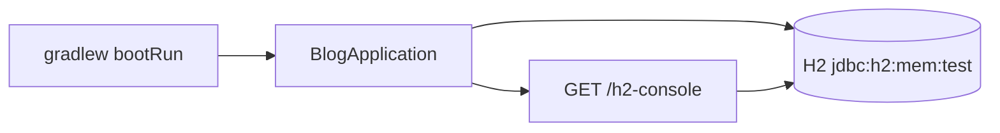
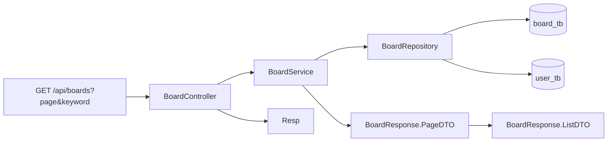
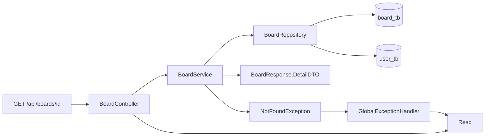
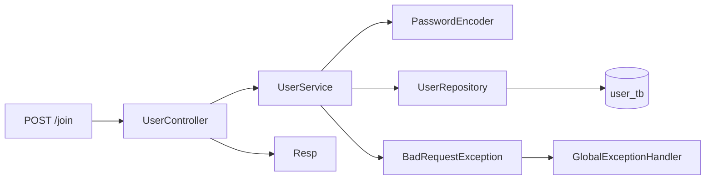
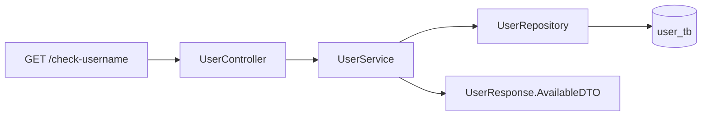
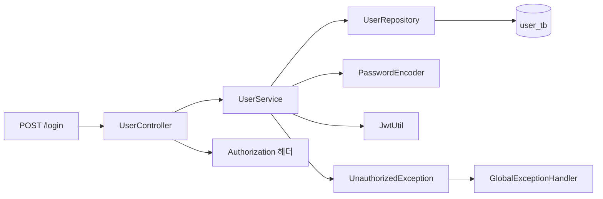
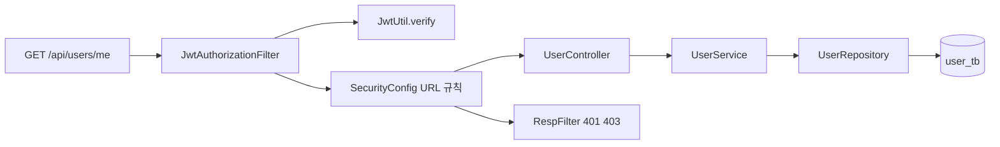
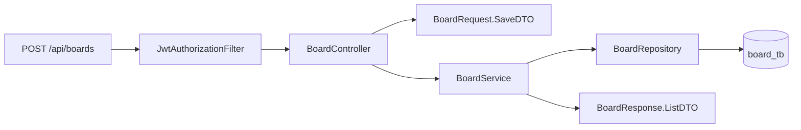

# 시나리오별 구조도

## 서버 실행과 H2 콘솔 접속

만든 장: project-setup
맡는 파일
- server-spring/build.gradle
- server-spring/src/main/java/com/newtenco/blog/BlogApplication.java
- server-spring/src/main/resources/application.properties

## 글 목록 보기와 검색

만든 장: board-list, board-paging
맡는 파일
- server-spring/src/main/java/com/newtenco/blog/board/BoardController.java
- server-spring/src/main/java/com/newtenco/blog/board/BoardService.java
- server-spring/src/main/java/com/newtenco/blog/board/BoardRepository.java
- server-spring/src/main/java/com/newtenco/blog/board/BoardResponse.java
- server-spring/src/main/java/com/newtenco/blog/board/Board.java
- server-spring/src/main/java/com/newtenco/blog/user/User.java
- server-spring/src/main/java/com/newtenco/blog/core/util/Resp.java
- server-spring/src/main/resources/db/data.sql

## 글 상세 보기

만든 장: board-detail
맡는 파일
- server-spring/src/main/java/com/newtenco/blog/board/BoardController.java
- server-spring/src/main/java/com/newtenco/blog/board/BoardService.java
- server-spring/src/main/java/com/newtenco/blog/board/BoardRepository.java
- server-spring/src/main/java/com/newtenco/blog/board/BoardResponse.java
- server-spring/src/main/java/com/newtenco/blog/core/handler/errors/NotFoundException.java
- server-spring/src/main/java/com/newtenco/blog/core/handler/GlobalExceptionHandler.java
- server-spring/src/main/java/com/newtenco/blog/core/util/Resp.java

## 회원가입

만든 장: user-join
맡는 파일
- server-spring/src/main/java/com/newtenco/blog/core/SecurityConfig.java
- server-spring/src/main/java/com/newtenco/blog/user/UserController.java
- server-spring/src/main/java/com/newtenco/blog/user/UserService.java
- server-spring/src/main/java/com/newtenco/blog/user/UserRepository.java
- server-spring/src/main/java/com/newtenco/blog/user/UserRequest.java
- server-spring/src/main/java/com/newtenco/blog/user/UserResponse.java
- server-spring/src/main/java/com/newtenco/blog/user/User.java
- server-spring/src/main/java/com/newtenco/blog/core/handler/errors/BadRequestException.java
- server-spring/src/main/java/com/newtenco/blog/core/handler/GlobalExceptionHandler.java

## 아이디 중복 확인

만든 장: user-join
맡는 파일
- server-spring/src/main/java/com/newtenco/blog/user/UserController.java
- server-spring/src/main/java/com/newtenco/blog/user/UserService.java
- server-spring/src/main/java/com/newtenco/blog/user/UserRepository.java
- server-spring/src/main/java/com/newtenco/blog/user/UserResponse.java

## 로그인

만든 장: user-login
맡는 파일
- server-spring/src/main/java/com/newtenco/blog/user/UserController.java
- server-spring/src/main/java/com/newtenco/blog/user/UserService.java
- server-spring/src/main/java/com/newtenco/blog/user/UserRepository.java
- server-spring/src/main/java/com/newtenco/blog/user/UserRequest.java
- server-spring/src/main/java/com/newtenco/blog/user/UserResponse.java
- server-spring/src/main/java/com/newtenco/blog/core/util/JwtUtil.java
- server-spring/src/main/java/com/newtenco/blog/core/handler/errors/UnauthorizedException.java
- server-spring/src/main/java/com/newtenco/blog/core/handler/GlobalExceptionHandler.java
- server-spring/src/main/java/com/newtenco/blog/core/SecurityConfig.java
- server-spring/src/main/resources/application.properties

## 내 정보 보기 (토큰 인증)

만든 장: jwt-auth
맡는 파일
- server-spring/src/main/java/com/newtenco/blog/core/filter/JwtAuthorizationFilter.java
- server-spring/src/main/java/com/newtenco/blog/core/util/JwtUtil.java
- server-spring/src/main/java/com/newtenco/blog/core/util/RespFilter.java
- server-spring/src/main/java/com/newtenco/blog/core/SecurityConfig.java
- server-spring/src/main/java/com/newtenco/blog/user/UserController.java
- server-spring/src/main/java/com/newtenco/blog/user/UserService.java

## 글쓰기

만든 장: board-write
맡는 파일
- server-spring/src/main/java/com/newtenco/blog/board/BoardController.java
- server-spring/src/main/java/com/newtenco/blog/board/BoardService.java
- server-spring/src/main/java/com/newtenco/blog/board/BoardRequest.java
- server-spring/src/main/java/com/newtenco/blog/board/Board.java
