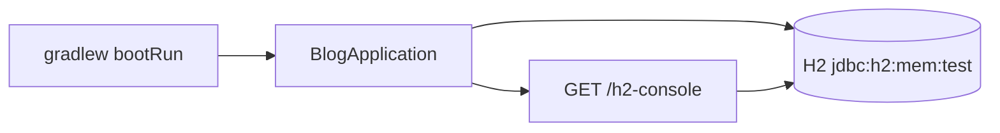

# 시나리오별 구조도

## 서버 실행과 H2 콘솔 접속

만든 장: project-setup
맡는 파일
- server-spring/build.gradle
- server-spring/src/main/java/com/newtenco/blog/BlogApplication.java
- server-spring/src/main/resources/application.properties
